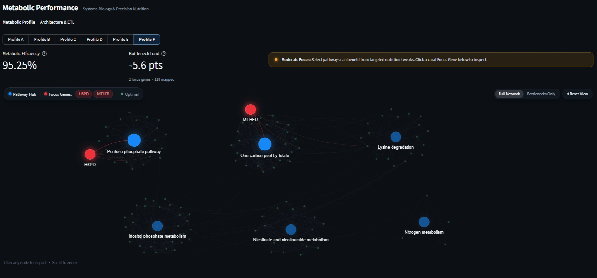
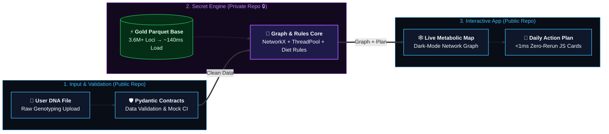

# 🧬 Metabolic Pathway App

[](https://<SEU-LINK-DO-STREAMLIT>.streamlit.app)
[](#-system-architecture--ip-boundary)
[](#-public-sdk--repository-structure)

**Core Stack:** `Python 3.10+` • `Apache Parquet (PyArrow)` • `Pandas` • `NetworkX` • `Concurrent Futures (Multithreading)` • `Pydantic` • `Streamlit` • `Client-Side JS Injection` • `Pytest` • `GitHub Actions`



---

## 💡 What It Is & Why It Is Revolutionary

The engine (powering the live **[Metabolic Performance App](https://<SEU-LINK-DO-STREAMLIT>.streamlit.app)**) turns a raw DNA file into a **live, interactive map of your metabolism**—pinpointing hidden biochemical bottlenecks and telling you **exactly what to eat today** to optimize them.

### Why This Changes the Game
**Every consumer DNA app on the market runs on 1990s spreadsheet logic:** *"You have variant X → read this generic PDF."*

**Your body isn't a spreadsheet—it's a domino chain.** When one enzyme slows down, everything downstream backs up. By modeling human metabolism as a **live directed graph** instead of flat lookup tables, this engine catches what traditional tests completely miss:

- **Exposes the Domino Effect:** Reveals how multiple minor genetic variations stack up to bottleneck an entire metabolic cascade.
- **From DNA to Your Daily Plate:** Click any bottleneck on the interactive network to get a clear, prioritized **Daily Nutrition & Lifestyle Action Plan**—zero medical jargon.
- **Instant & Deterministic:** Distills millions of genetic markers into an interactive visual graph in **~140 ms**—with zero cloud database lag and zero AI hallucinations.

| Raw Records Processed | Curated Knowledge Graph | Cold-Start Load Time | Network Latency Reduction | UI Node Inspection |
| :---: | :---: | :---: | :---: | :---: |
| **3.6M+ Loci** | **1.1M+ Associations** | **~140 ms** *(Columnar RAM)* | **~88.6%** *(ThreadPool)* | **< 1 ms** *(Zero-Rerun JS)* |

---

## 🎯 Current Industry Problems Solved

| Industry Bottleneck | The Status Quo in Health-Tech | How Metabolic Pathway App Solves It |
| :--- | :--- | :--- |
| **1. Siloed "1-Marker, 1-Trait" Reports** | Legacy consumer health platforms evaluate genetic variants in isolation, generating fragmented PDFs that miss how multiple markers compound inside the same biochemical cascade. | **Directed Metabolic Network Modeling:** Reconstructs interconnected biochemical pathways as directed graphs (`NetworkX`), pinpointing systemic bottlenecks and prioritizing where intervention actually matters. |
| **2. Data Overload vs. Daily Actionability** | Users are handed dense scientific jargon and raw statistical scores with zero clarity on what to actually put on their plate tomorrow morning. | **Interactive Triage & Daily Action Cards:** Pairs severity-weighted pathway triage with an interactive dark-mode graph where clicking any bottleneck opens a clear, deterministic **Daily Action Plan**. |
| **3. Cloud DB Costs, Latency & LLM Hallucinations** | Real-time graph queries and generative AI wrappers are slow, expensive to scale, prone to rate limits, and unsafe for deterministic health guidance. | **Zero-DB Columnar + Deterministic Core:** Distills **3.6M+ raw records** and **1.1M+ associations** into pre-indexed Apache Parquet (`~140 ms` load) paired with a deterministic rules engine (`< 0.1 ms`, `$0` inference cost, zero hallucination risk). |

---

## 🏗️ System Architecture & IP Boundary

To protect proprietary domain heuristics, curated datasets, and clinical weighting rules while demonstrating production engineering standards, the system flows linearly from a **public validation shell** through a **private core engine**:



---

## ⚡ Performance Engineering & Architectural Trade-Offs

| Bottleneck / Layer | Engineering Solution | Measured Production Impact |
| :--- | :--- | :--- |
| **High-Cardinality Storage** | Immutable `PyArrow` Apache Parquet + in-memory cache persistence | **>80%** disk compression; cold load in **~140 ms** and warm user switches in **< 5 ms** (< 30 MB RAM). |
| **External API Fan-Out** | Bounded `ThreadPoolExecutor` with per-worker timeout isolation | Parallelizes upstream discovery calls, cutting network wait time by **~88.6%** with graceful degradation. |
| **Graph Hairball Complexity** | Algorithmic scope pruning + peak-signal deduplication prior to graph build | Prevents exponential edge explosion and memory spikes while preserving maximum analytical signal. |
| **Server-Side UI Latency** | Custom client-side JavaScript event injection over rendered graph canvas | Delivers node-level inspection cards in **< 1 ms** in the browser with **zero backend round-trips**. |

### Key Architectural Decisions

- **Embedded Columnar Storage over Managed RDBMS (PostgreSQL/Neo4j):** Eliminates network serialization overhead, connection-pool exhaustion, and recurring cloud DB costs for a read-heavy, immutable analytical workload.
- **Deterministic Rules Engine over Runtime LLMs:** Guarantees sub-millisecond execution (`< 0.1 ms`), zero token costs, immunity to third-party rate limits (`HTTP 429`), and 100% auditable, deterministic health recommendations.

---

## 📂 Public SDK & Repository Structure

This repository exposes the **typed domain contracts, concurrent execution harness, mock engine adapter, and automated test suite** used in production. Proprietary ETL pipelines, curated datasets, graph weighting heuristics, and clinical rule tables reside in a private repository.

```text
metabolic-pathway-engine/
├── .github/workflows/ci.yml        # Automated pytest verification pipeline
├── assets/
│   └── demo.gif                    # Live application walkthrough
├── src/
│   └── metabolic_engine/
│       ├── __init__.py             # Public SDK exports
│       ├── contracts.py            # Strict Pydantic schemas & Engine Protocol
│       ├── graph_renderer.py       # NetworkX + PyVis zero-rerun HTML/JS renderer
│       ├── resilience.py           # Concurrent worker pool & timeout isolation
│       └── mock_adapter.py         # Deterministic sandbox adapter for local dev & CI
├── tests/
│   ├── test_contracts.py           # Boundary validation & schema integrity tests
│   ├── test_graph_renderer.py      # Graph styling & client-side JS injection tests
│   ├── test_mock_adapter.py        # Sandbox profile & engine factory tests
│   └── test_resilience.py          # Concurrency, partial-failure & timeout tests
├── .gitignore
├── app.py                          # Decoupled Streamlit presentation layer
├── pyproject.toml
└── README.md
```

### Running the Verification Suite Locally

```bash
git clone [https://github.com/kccas35/metabolic-pathway-engine.git](https://github.com/kccas35/metabolic-pathway-engine.git)
cd metabolic-pathway-engine
pip install -e ".[dev]"
pytest
```

---

## 🛡️ Data Privacy & Scope Disclaimer

- **Synthetic & Anonymized Demonstration Profiles:** All live demonstration cohorts use anonymized, non-identifiable profiles and contain zero Protected Health Information (PHI).
- **Educational & Wellness Scope:** Built for computational systems-biology visualization and precision wellness education. Not intended as a medical device or clinical diagnostic tool.

---

## 📬 Technical Interviews & Architectural Deep-Dives

Want to review the private graph-weighting algorithms, ETL benchmarks, or system design trade-offs in a technical interview?

- **GitHub:** [@kccas35](https://github.com/kccas35)
- **LinkedIn:** [Connect on LinkedIn](https://<SEU-LINKEDIN>)
